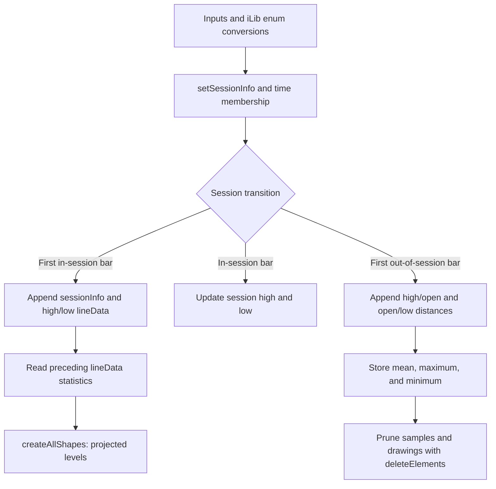

# Session Average - Developer Guide

This guide follows the data and drawing lifecycle in [Session-Average.ps](Session-Average.ps). It explains when statistics become available and how they become the next session's projected levels. Helper contracts and the owning [release record](AGENTS.md#current-release) live in [AGENTS.md](AGENTS.md).

## Core Philosophy and Data Flow

**Configure hours -> detect session -> project prior statistics -> collect extremes -> store statistics -> prune history.** The source owns both calculations and chart objects. Its imported `InputLibrary` supplies enum conversions, not the session engine. High and low distances are separate populations measured from the session open.

Arrows show calls or state handoffs in the current source. Drawing creation is gated by the source's sample-count condition; the diagram does not imply projections exist during warmup.

## 1. Configure the Session and Appearance

`i_timeZone.timezoneToString()` provides `TIMEZONE`. `i_sessionTime.setSessionInfo(TIMEZONE)` parses start/end hours, their offsets, and a duration. The parser adds `TIME_DAY` when the closing offset is not later than the opening offset, allowing overnight definitions. This is the existing local implementation, rather than the newer shared session engine used by other indicators.

Persistent `lineInputs` objects resolve each line's color, width, style, label settings, and optional fill once per script run. An input change restarts the script and rebuilds those values.

| Input family | Meaning |
| --- | --- |
| Timezone / Session | Timezone first, then session hours on a separate line. |
| Session Period | Target for calculation history; default 14. |
| Sessions Displayed | Drawing-history target; default 4. |
| Open / average / custom rows | Visibility, color, width, style, label toggle. |
| Average fill rows | Visibility checkbox then fill color. |
| Factor/Mode | Custom multiplier then Average or Range base. |
| Labels and distance text | Independent global label controls and distance-text appearance. |

## 2. Detect Session Boundaries

`time(timeframe.period, initSession.hours, TIMEZONE)` supplies session membership. `firstSessionBar` requires current membership and missing membership on the preceding chart bar. `lastSessionBar` is the reverse transition.

The script uses chart bars without intrabar requests. If a chart candle spans a session boundary, its OHLC values are not split into in-session and out-of-session portions. The drawing starts at the detected chart-bar timestamp and ends at that timestamp plus the parsed duration. It does not automatically adopt the timing and gap rules of Single Session or UtilityLibrary1CG.

## 3. Project the Preceding Statistics

At the first session bar, the script appends a `sessionInfo` and corresponding high/low `lineData` records. If `array.size(sessionArr) >= i_sampleSize - 1`, it reads the preceding drawing records and creates levels for the new session. The condition counts stored session records, including the new one; it is not an explicit completed-sample readiness check.

Let `O` be the new session open, `H` the stored mean high/open distance, and `L` the stored mean open/low distance:

| Level | High side | Low side |
| --- | --- | --- |
| Average | `O + H` | `O - L` |
| Double | `O + 2H` | `O - 2L` |
| Triple | `O + 3H` | `O - 3L` |
| Custom Average, factor `f` | `O + fH` | `O - fL` |
| Custom Range, factor `f` | `O + f * max(high/open distances)` | `O - f * max(open/low distances)` |

Prices are rounded with the source's symbol-precision calculation. The custom expressions use the current chart `open`, which is also used to initialize the new session's open.

For a numeric illustration, stored high distances of 6 and 10 have mean 8; stored low distances of 4 and 8 have mean 6. A new open of 100 projects average levels at 108 and 94, double levels at 116 and 88, and triple levels at 124 and 82. A 1x Range projection uses 110 and 92. These are example stored samples, not a recommendation to set Session Period to 2.

`createAllShapes` returns line, label, and box handles. Labels require global label visibility, that line's visibility, and its label toggle. Average boxes can be visible without a line. With a line visible and fill disabled, a transparent box can still carry distance text. Custom levels use labels rather than filled bands.

## 4. Collect and Store Distances

Every in-session chart bar updates the latest session's high and low. At `lastSessionBar`, the source appends `highPrice - openPrice` and `openPrice - lowPrice` to separate arrays. It stores each array's mean, maximum, and minimum in the latest high/low `lineData` records. The following session reads those stored values; the current projection is not moved by developing extremes.

Statistics are computed **before** excess samples are shifted. At steady state, the calculation at that update can therefore use an additional completed occurrence beyond the selected sample target. Preserve this order in a documentation/layout change and validate it explicitly before claiming an exact N-session sample.

## 5. Prune and Report

The sample arrays and `sessionArr` are trimmed against Session Period. High/low drawing records are trimmed separately against Sessions Displayed, and `deleteElements` removes the associated chart objects. A last-bar warning table compares the stored session count with the sample input. That warning is a count check, not a guarantee that preceding statistics or indexes are valid for every setting.

## Critical Execution Rules

- Keep the legacy `InputLibrary` import pin. Its source and owning release record are absent locally; migrating it is a separate change.
- Preserve array pairing, first/in-session/last-bar ordering, and timestamp drawing coordinates during input work.
- Keep fill visibility before its color picker. The checkbox at the end of a line-appearance row controls labels; it is separate from fill visibility. Preserve the default values when arranging controls.
- Keep one short first title per inline row and exactly `""` afterward. Use row tooltips to explain unlabeled controls.
- Very small sample inputs can reach preceding-record indexing before a preceding record exists. Treat this as a known source-review concern requiring a focused runtime fix or publication validation, rather than implying the alignment edit repaired it.
- Check overnight hours, exchange/date boundaries, DST, gaps, insufficient history, and replay in TradingView. Source inspection alone cannot establish those behaviors.

## Integration and Validation

Add the indicator directly to a chart; it exposes no exported API or built-in alerts. Start with the default sample/history settings and a chart timeframe aligned to the session boundaries. See [AGENTS.md](AGENTS.md#verification) for completed local checks and pending validation. User-facing copy is in [publication-document.txt](publication-document.txt).
