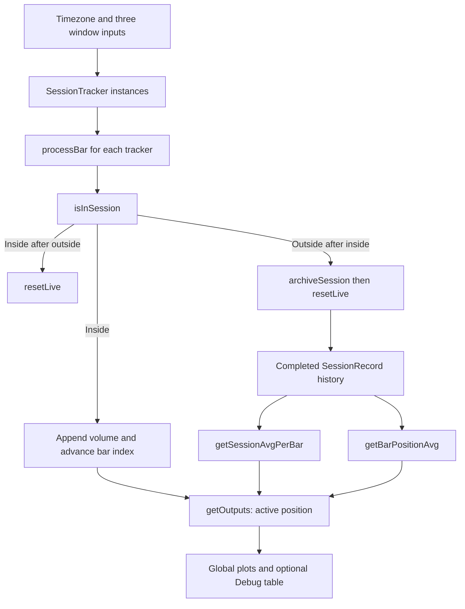

# Session Volume - Developer Guide

This guide traces the session trackers, completed history, averaging formulas, and output gates in [Session-Volume.ps](Session-Volume.ps). [AGENTS.md](AGENTS.md) owns the helper contracts and [published release record](AGENTS.md#current-release).

## Core Philosophy and Data Flow

**Resolve shared timezone -> process three trackers -> archive completed windows -> calculate historical baselines -> gate plots -> render diagnostics.** Each tracker owns independent history, even when windows overlap. Both baselines use completed records; the current session supplies the ordinal bar position and live histogram volume.



Arrows represent current call/data dependencies. `processBar` runs before `getOutputs`, so the active zero-based lookup position is the tracked count minus one.

## 1. Resolve Windows in One Timezone

`timezoneToString` maps the Exchange option to `syminfo.timezone`; other enum values resolve to their timezone string. All three windows use that one result. The defaults are 08:00-17:00, 03:00-12:00, and 19:00-04:00 with New York selected. They are not individually converted from separate market timezones.

The source appends `:23456` to each input session specification. Document that exact weekday mask and verify its overnight boundary behavior on the chosen symbol. Membership is `not na(time(timeframe.period, sessionStr, tzString))`; no lower-timeframe reconstruction or exchange-holiday calendar is applied.

The Sessions settings group contains three compact rows. Each row begins with the Session 1, Session 2, or Session 3 enable checkbox, followed by its unlabeled hours and color. All three controls share that row's inline key. Hours and color become inactive when the corresponding checkbox is off.

## 2. Accumulate and Archive Each Tracker

Each persistent `SessionTracker` stores enable state, window/color settings, previous membership, current count/total/volume array, and completed `SessionRecord` history.

`processBar` handles three cases in this order:

1. Previously inside, now outside: archive current data and reset live state.
2. Previously outside, now inside: reset live state for the opening.
3. Currently inside: append the current chart bar's volume, add to the total, and increment the count.

`archiveSession` copies live samples into a completed record when the count is positive. It shifts the oldest record if history exceeds `i_sampleSize`. No complete-history requirement is imposed; a partially filled history is used immediately. The first loaded session can itself be partial.

The lifecycle requires an observed out-of-session bar to archive. Continuous membership across observed bars does not create a new record merely because a date changed. Daily/near-continuous windows and gaps therefore need explicit chart checks.

## 3. Compute the Two Baselines

`getSessionAvgPerBar` computes the mean of per-session mean volumes:

```text
sessionMean[j] = totalVolume[j] / barCount[j]
sessionBaseline = sum(sessionMean[j]) / numberOfStoredSessions
```

Every retained session has equal weight. This differs from pooling all volume and dividing by all bars when session lengths differ.

`getBarPositionAvg(pos)` takes the mean of `barVolumes[pos]` only from records long enough to contain that position. `getOutputs` calls it with `currentBarIndex - 1`. Positions are ordinal chart bars, not wall-clock timestamps or interpolated time buckets.

For example, completed records `[10, 30]` and `[30, 60, 90]` have per-session means 20 and 60. The Session Average is 40; pooling all five bars would give 44. The three positional averages are 20, 45, and 90, with only the longer record contributing to the last position. This is a calculation example, not an executed Pine test.

Empty history or a position with no contributing record returns zero. Volume values are not sanitized with `nz`; missing data can affect totals and averages. The developing session is excluded from history until its closing transition is observed.

## 4. Gate and Render the Outputs

| State | Histogram | That session's baselines |
| --- | --- | --- |
| Enabled and active | Current volume if any enabled window is active | Historical baselines, or zero during empty history. |
| Enabled and inactive | Depends on other active windows | Zero. |
| Disabled | Depends on other active windows | `na`, so no session line. |
| No enabled window active | Zero value with no bar color | Enabled inactive lines remain at zero. |

The histogram appears once, even during overlaps. It uses the up color when `close >= open`, otherwise the down color. Each active tracker contributes a 2-pixel Session Average line with 30 transparency and a 1-pixel Bar-Position Average line in its session color.

Plots use ordinary line style, so zero values outside sessions are actual plot values, not gaps. Changing timeframe changes membership sampling, bar counts, volume per bar, and position matching; baselines are not invariant across timeframes.

## 5. Inspect Diagnostics

The optional last-bar Debug table displays each session's two output averages and current tracked count, plus IN SESSION/IDLE status and the selected sample target. The source creates a table in that last-bar block. Do not describe diagnostics as a cached table lifecycle or a confirmed runtime performance improvement; repeated updates still need chart validation.

## Critical Execution Rules

- Keep `SessionTracker` and its arrays persistent with `var`; all trackers are processed before outputs are computed.
- Preserve equal weighting of session means and exclusion of short records from unavailable positions.
- Preserve zeros outside enabled windows and `na` for disabled-window baselines.
- Keep one short first title per inline row, empty secondary titles, aligned `group` arguments, and tooltips describing hours/color or up/down order.
- Input-layout changes preserve enable defaults, the shared timezone, weekday mask, sample bounds, active/display arguments, and calculation code.
- Validate live updates, missing bars/volume, partial first records, overlaps, overnight windows, and continuous sessions before claiming runtime correctness. No alerts or trading automation are implemented.

## Integration and Validation

Add this standalone indicator to an intraday chart with suitable volume data. Use Debug to compare observed baselines with manually calculated completed records. See [AGENTS.md](AGENTS.md#verification) for local checks and pending runtime validation, and use [publication-document.txt](publication-document.txt) for public copy.
